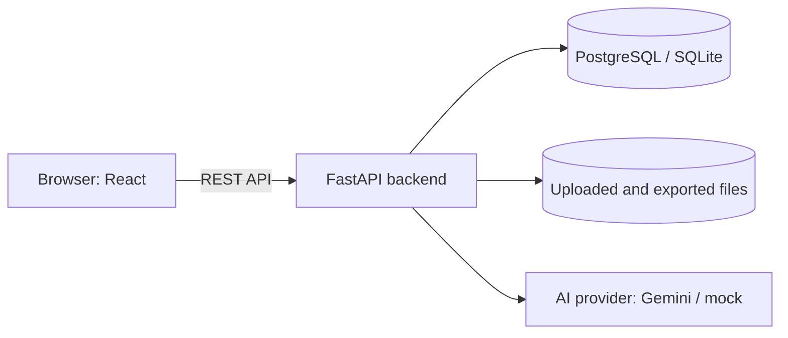

# Rotpunkt Übersetzungstool

A browser-based AI translation tool for kitchen documents (Word, Excel, PDF), German ↔ English. It respects the
glossary, keeps product names and article numbers unchanged, and nothing is final until a reviewer approves it.

## Tools required

| Tool | Version | Needed for |
|---|---|---|
| Docker Desktop | current | running the app with Docker; regenerating the API client |
| Python | 3.12 | backend |
| Node.js | 20 or newer | frontend (React 19, Vite 6) |
| Gemini API key | free | real translations ([aistudio.google.com](https://aistudio.google.com) → Get API key). Without a key, `LLM_PROVIDER=mock` starts the app, but it only translates a few known words |

## Run with Docker

1. Start Docker Desktop.
2. In the project folder, create the settings file: `copy .env.example .env` (macOS/Linux: `cp .env.example .env`).
3. Open `.env` and set `GEMINI_API_KEY=...` (or `LLM_PROVIDER=mock` to try the app without a key; see below).
4. Start: `docker compose up -d --build`
5. Open **http://localhost:8000** (API documentation: http://localhost:8000/docs).
6. Stop: `docker compose down`

Docker runs the app with PostgreSQL. The database is created and migrated automatically.

## Run for development

The backend runs on port 8000, so stop the Docker app first (`docker compose down`). Commands are for Windows
PowerShell; on macOS/Linux use `.venv/bin/` instead of `.venv\Scripts\`.

**Backend** (API on http://localhost:8000, SQLite, reloads on change)

1. `cd backend`
2. `python -m venv .venv`
3. `.venv\Scripts\pip install -r requirements-dev.txt`
4. `copy ..\.env.example ..\.env` (once; then set the Gemini key as above)
5. `.venv\Scripts\python -m uvicorn app.main:app --reload --port 8000`

**Frontend** (UI on http://localhost:5173, reloads on change, forwards `/api` to the backend)

1. `cd frontend`
2. `npm install`
3. `npm run dev`

**API client** (only after changing the backend API; needs Docker running)

1. `cd backend` → `.venv\Scripts\python export_openapi.py` (writes `frontend/openapi.json`)
2. `cd frontend` → `npm run openapi:generate-specs` (writes `frontend/src/shared/api/generated/`)

## Try it

* **Users** (development only): `admin` / `admin123`, `reviewer` / `reviewer123`, `translator` / `translator123`.
  New accounts can also be created on the sign-in page.
* **Sample files** in [`samples/`](samples): a German PDF, Word and Excel document (one page each) and a glossary to
  import (`glossar_beispiel.xlsx`).
* **Flow:** New project (upload) → Translate (preview) → check and edit → quality check → approve → export.

## How the AI part works

1. **Split:** the file is cut into segments (Word paragraph, Excel cell, PDF text block). Each remembers where it came
   from, so the translation goes back to exactly that place.
2. **Glossary first:** before the AI runs, the app finds glossary terms (also synonyms and plural forms) and article
   numbers in each segment. They are given to the AI as fixed rules: "translate X as Y", "keep HS-9001 unchanged".
3. **Translate:** Gemini translates the segments in batches and marks further terms as technical, ambiguous (with
   alternatives) or unknown.
4. **Check:** the app verifies that every glossary term really appears in the translation, and the quality check looks
   for missing translations, different numbers, inconsistent terms and frequent terms missing from the glossary.
5. **Human decides:** the translator edits, the reviewer approves. Only then can it be exported.

The AI sits behind a small interface (`backend/app/translation/llm.py`); another provider (DeepL, Azure OpenAI, a
local model) can be added there. The Gemini model is chosen under *Einstellungen*. An offline mock that only knows a
few kitchen words is used by the automated tests; `LLM_PROVIDER=mock` turns it on for the whole server.

## Architecture

* **Backend** (`backend/app/`): Python, FastAPI, SQLAlchemy, Alembic. One folder per feature (`projects`, `glossary`,
  `translation`, `quality`, `review`, `export`, ...), each with its router, schemas and logic.
* **Frontend** (`frontend/src/`): React, TypeScript, TanStack Query, Tailwind. One folder per feature (`projects`,
  `glossary`, `users`, ...). Each feature talks to the backend only through its service in `api/`
  (e.g. `ProjectService.useFetchProject(id)`), which uses the API client generated from the backend's schema.
* **Docker:** one image serves the API and the built UI; Docker Compose adds PostgreSQL.

## Settings

All settings are environment variables, kept in `.env` (see [`.env.example`](.env.example)). The important ones:

| Variable | Meaning |
|---|---|
| `GEMINI_API_KEY` | Gemini key for real translations |
| `LLM_PROVIDER` | `gemini`, or `mock` (offline test mode, no key, translates only a few known words) |
| `ENVIRONMENT` | `production` requires a strong `SECRET_KEY` and `SEED_DEMO_DATA=false` |
| `ALLOW_REGISTRATION` | `false` = only admins create users |
| `DATABASE_URL` | default: SQLite in `data/`; Docker sets PostgreSQL |

## Tests

| What | Command |
|---|---|
| Backend tests | `cd backend` → `.venv\Scripts\python -m pytest` |
| Frontend checks and tests | `cd frontend` → `npm run check` |
| End-to-end (browser) | `cd frontend` → `npx playwright install chromium` (once) → `npm run e2e` |
