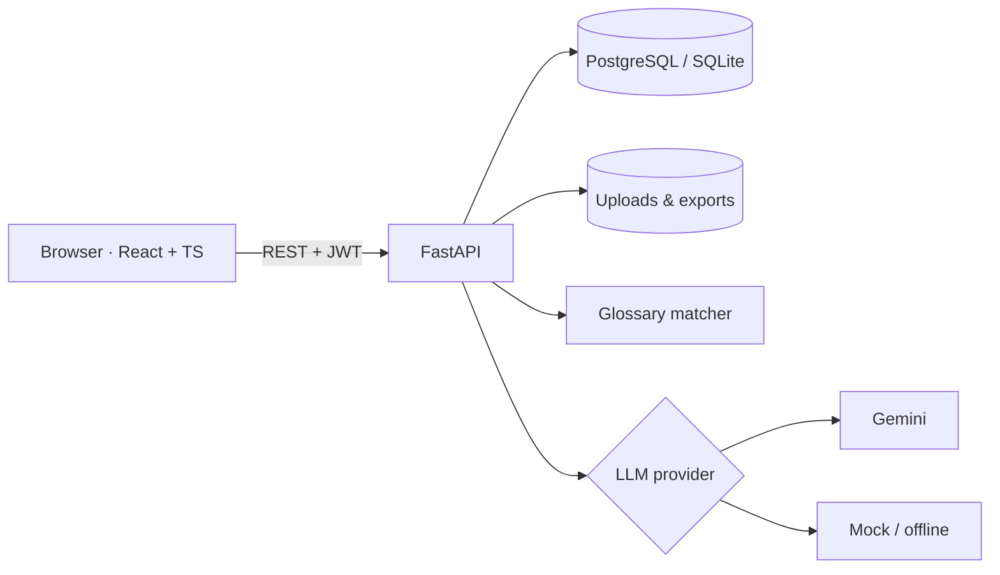

# Rotpunkt Übersetzungstool

Browser-based AI translation tool for kitchen-industry documents (Word, Excel, PDF). Glossary terms, technical terms
and protected product names / article numbers are respected, every translation is a **project**, and nothing becomes
final without a **human approval**. Implemented for **German ↔ English** (take-home task for Rotpunkt Küchen).

> **Why was each tool and library chosen?** See the [engineering log](docs/ENGINEERING.md) (decisions, standards, quality gates).

## Quick start

**Docker (one central server, PostgreSQL):**

```bash
cp .env.example .env        # add GEMINI_API_KEY (free: https://aistudio.google.com) or set LLM_PROVIDER=mock
docker compose up --build   # → http://localhost:8000   (API docs / Swagger: http://localhost:8000/docs)
```

**Local development (SQLite, no Docker):**

```bash
cd backend && python -m venv .venv && .venv/Scripts/pip install -r requirements-dev.txt   # Linux/macOS: .venv/bin/pip
.venv/Scripts/uvicorn app.main:app --reload --port 8000                                   # API + Swagger
cd frontend && npm install && npm run dev                                                  # UI on :5173 (proxies /api)
```

Demo users: `translator/translator123`, `reviewer/reviewer123`, `admin/admin123`. Sample files are in [`samples/`](samples)
(a German assembly manual, a price list, a glossary to import). With `LLM_PROVIDER=mock` the whole app runs offline with a
tiny dictionary translator, which is what the automated tests use.

## Workflow

`Project → upload → languages → preview → highlight terms → manual correction → quality check → approval → export → archive`

* **Upload** creates the project automatically and detects text, structure (paragraphs/cells/blocks) and language.
* **Start translation** only creates a **preview** (original left, translation right). The final version is stored when a
  *Prüfer* clicks **Übersetzung freigeben**; export is blocked until then.
* Click a highlighted term: used translation, alternatives, description, glossary entry, direct edit
  (this segment / whole project) and "add to glossary".

## How the AI part works

1. The file is split into **segments** with a locator (docx paragraph, xlsx cell, pdf block) so text goes back to exactly
   the same place – Word/Excel keep their formatting and formulas.
2. **Deterministic glossary matching** (synonyms, inflection tolerant, longest match first) and **article-number detection**
   run *before* the model. Matches are passed to the LLM as hard constraints ("do not translate" terms stay unchanged).
3. The LLM (Gemini, structured JSON output) translates batches of segments and classifies *further* terms as
   technical / ambiguous (with alternatives) / unknown.
4. **Post-verification:** every glossary term must actually appear in the translation, otherwise it is flagged. This
   check also re-runs after every manual edit.
5. The quality check adds: untranslated text, number mismatches, line-break/length problems, contradicting translations
   of the same term, and frequent technical terms that are missing from the glossary.

The LLM sits behind a small provider interface ([`services/llm.py`](backend/app/services/llm.py)); Gemini and an offline
mock are included, switchable in *Einstellungen*. DeepL, Azure OpenAI (EU) or a local Ollama model plug in the same way.

## Architecture



* **Backend:** Python 3.12, FastAPI, SQLAlchemy 2, Pydantic v2 · python-docx, openpyxl, PyMuPDF, ReportLab.
* **Frontend:** React 19, TypeScript (strict), React Query, Tailwind. API types are **generated from the Swagger schema**
  (`python backend/export_openapi.py && npm --prefix frontend run gen:api`), so frontend and backend cannot drift.
* **API docs:** Swagger UI at `/docs`, ReDoc at `/redoc`.
* **Deployment:** one Docker image serves API and built UI (central server, no client install); Compose adds PostgreSQL.
* Long translations run as a background job with a progress bar; Gemini's free-tier rate limit is handled by throttling
  and retry with backoff.

## Requirement coverage

| # | Requirement | Status |
|---|---|---|
| 1 | Project management (create, copy, archive, reopen, status, search/filter) | ✅ |
| 2 | Upload docx / xlsx / pdf, text + structure + language detection | ✅ · InDesign: Phase 2 (`.imdd` is probably `.indd`) |
| 3 | Source auto-detect or manual, one or several target languages | ✅ (DE, EN) |
| 4 | Preview only, original left / translation right | ✅ |
| 5 | 5 highlight colours + click details (translation, alternatives, description, glossary entry, edit) | ✅ colours configurable |
| 6 | Manual editing, replace terms, add to glossary, comments, regenerate a segment | ✅ |
| 7 | Glossary module: CRUD, synonyms, languages, "do not translate", Excel import/export, duplicates, versioning, approval status | ✅ |
| 8 | Quality check before approval with warnings | ✅ |
| 9 | Final translation only after "Übersetzung freigeben" | ✅ |
| 10 | Export Word / Excel / PDF, options (translation only, original + translation, report, comments), free Excel columns, templates | ✅ |
| 11 | History: original, preview, final, exports, editor, date, glossary version, number of changes, status | ✅ |
| 12 | Search: project, file, customer, language, terms, editor, period | ✅ |
| 13 | Roles Translator / Reviewer / Admin (enforced server-side) | ✅ |
| 14 | Dashboard | ✅ |
| 15 | Settings: languages, export defaults, colours, AI model, users, rights, API interfaces | ✅ (DeepL: via provider interface, not implemented) |
| 16 | Central web server, browser only, multi-user, responsive | ✅ |
| 17 | Planned workflow | ✅ |

**Assumptions:** only DE ↔ EN; data in examples is fictional; translators propose glossary terms (draft) which a
reviewer/admin approves; "Projekt wird archiviert" happens after export (switchable in the export dialog).

**Known limitations:** PDF input is text-only (no OCR) and PDF output is re-typeset, not the original layout; within one
Word paragraph only the first run's formatting is kept; no real-time multi-user editing of the same segment.

## Data protection (GDPR) and production notes

* No data leaves the server except the text sent to the configured LLM. For production use an **EU-hosted or on-premise
  model** (provider interface); the Gemini *free tier* may use inputs for training – use it with fictional data only.
* Secrets only via environment variables; passwords hashed (PBKDF2-SHA256); JWT auth; role checks on every endpoint;
  all edits, approvals and exports record the user and time.
* Put a reverse proxy with HTTPS in front (Caddy/Nginx); replace `SECRET_KEY`; change the demo passwords.
* Next steps: Alembic migrations, SSO (Entra ID), translation memory with pgvector (Phase 2), OCR, InDesign via IDML,
  job queue (Celery/RQ), evaluation set (glossary compliance, COMET) to compare models.

## Quality gates

```bash
cd backend  && ruff check . && ruff format --check . && pyright -p .. && pytest        # pyright: strict
cd frontend && npm run check                      # tsc + ESLint (strictTypeChecked + a11y) + 50 unit/component tests
cd frontend && npm run knip && npm run format:check && npm audit --audit-level=high
cd frontend && npm run e2e                        # Playwright end-to-end + axe accessibility scan (own backend, mock translator)
```

CI runs the same commands ([`.github/workflows/ci.yml`](.github/workflows/ci.yml)); Git hooks (Husky) format staged files,
enforce Conventional Commits and run the frontend checks before a push. Why each tool was chosen: [engineering log](docs/ENGINEERING.md).
